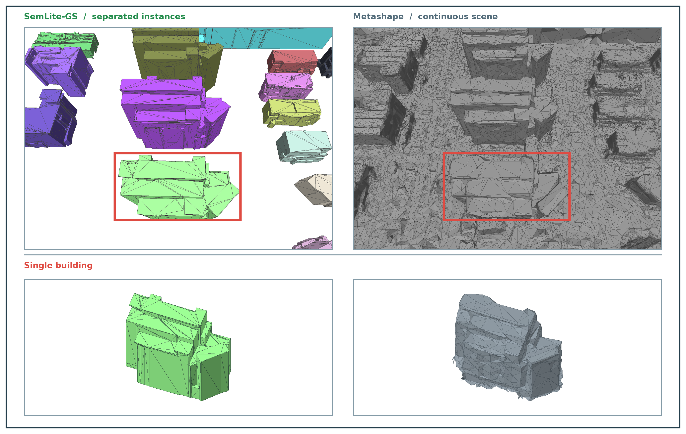

# SemLite-GS: Semantic-Selective Parallel Gaussian Splatting for Lightweight Building Reconstruction from UAV Oblique Imagery

Tengfei Wang<sup>†a</sup>, Xin Wang<sup>†a</sup>, Zihan Li<sup>a</sup>, Quanjian Ji<sup>a</sup>, Yifei Yu<sup>a</sup>, Dong Lin<sup>b</sup>, Rongjun Qin<sup>c</sup> and Zongqian Zhan<sup>a,*</sup>

### [Project Page]() | [arXiv]()

<p align="center">
  
</p>

SemLite-GS reconstructs lightweight building meshes from multi-view UAV imagery. Given registered images and camera parameters, it produces instance-level Gaussian representations, lightweight building meshes with instance IDs, and merged scene meshes. The pipeline consists of three components:

- **Orthographically Anchored Instance Propagation**
- **Semantic-Selective Parallel PGSR**
- **Plane-Constrained Lightweight Mesh Reconstruction**

## Installation

The project requires Linux, Conda, an NVIDIA GPU with a compatible driver, and the CUDA 11.8 development toolkit. Enter the project directory and install the build dependencies:

```bash
cd SemLite-GS
sudo apt-get install build-essential libeigen3-dev libcgal-dev libgmp-dev libmpfr-dev
```

Set the CUDA path and run the environment setup script:

```bash
export CUDA_HOME=/usr/local/cuda-11.8
bash scripts/setup_envs.sh
```

The script installs Python dependencies, compiles native extensions, and creates four environments:

| Environment | Purpose |
|---|---|
| `semlite-fastgs` | Shared Gaussian initialization, orthographic rendering, and instance propagation |
| `semlite-sam3` | Building instance segmentation |
| `semlite-pgsr` | Parallel multi-instance refinement |
| `semlite-mesh` | Plane-constrained lightweight reconstruction and mesh export |

SAM3 weights are loaded from the configured path or local cache. If unavailable, they are downloaded automatically to the cache, rather than stored in the project directory. Before the first download, obtain access to the SAM3 model and sign in to Hugging Face:

```bash
conda activate semlite-sam3
hf auth login
```

To use an existing checkpoint, specify its path:

```bash
export SEMLITE_SAM3_CHECKPOINT=/path/to/sam3.pt
```

## Data Organization

Input images must be registered and undistorted beforehand. Organize the data in COLMAP format:

```text
data/
└── my_scene/
    ├── images/
    │   ├── image_001.jpg
    │   ├── image_002.jpg
    │   └── ...
    └── sparse/
        └── 0/
            ├── cameras.bin
            ├── images.bin
            └── points3D.bin
```

COLMAP text format is also supported. Cameras must use the `PINHOLE` or `SIMPLE_PINHOLE` model. Scene coordinates must use the Z axis as the vertical axis and metres as the unit of length. LiDAR point clouds are not required for reconstruction.

## Training and Reconstruction

### Scene Configuration

Copy the configuration template from the project root:

```bash
cp configs/scene.example.json configs/scene.local.json
```

Update the following settings:

| Setting | Description |
|---|---|
| `scene` | Scene name |
| `source` | Input data directory, e.g. `../data/my_scene` |
| `output` | Output directory, e.g. `../runs/my_scene` |
| `python` | Absolute paths to the Python executables in the four environments |
| `gpus` | GPU IDs to use, e.g. `[0, 1, 2]` |
| `processes_per_gpu` | Number of concurrent tasks per GPU |
| `instances_per_group` | Number of building instances refined in parallel within each group |
| `mesh_workers` | Number of parallel lightweight reconstruction processes |

Relative `source` and `output` paths are resolved against the configuration file's directory. Use the following command to locate each environment's Python executable and enter the paths in the `python` configuration:

```bash
for name in fastgs sam3 pgsr mesh; do
  conda run -n "semlite-$name" which python
done
```

### Full Pipeline

```bash
conda activate semlite-mesh
python -m semlite_gs run --config configs/scene.local.json
```

This command performs input loading and validation, shared Gaussian initialization, multi-view mask generation, frozen-context preparation, parallel multi-instance refinement, lightweight reconstruction, and scene export.

### Running Individual Stages

Generate multi-view instance masks:

```bash
python -m semlite_gs run --config configs/scene.local.json --to-stage propagate
```

After reviewing the instances, set `valid_ids` in the configuration to the building IDs to reconstruct. Use `null` to include all generated instances. Prepare the frozen context and run refinement:

```bash
python -m semlite_gs run --config configs/scene.local.json --from-stage guard --to-stage train
```

Generate lightweight meshes from the trained representations:

```bash
python -m semlite_gs run --config configs/scene.local.json --from-stage field
```

### Outputs

The default outputs are **instance-level 3DGS representations** and **lightweight meshes**.

| Output | File |
|---|---|
| Instance-level 3DGS representation | `point_cloud_instance_ID.ply` |
| Lightweight instance mesh | `instance_NNN/mesh.ply` |
| Merged lightweight scene mesh | `my_scene_lightweight_fused.ply` |

The instance-level 3DGS files store Gaussian positions, scales, rotations, opacities, and spherical harmonic coefficients. `ID` is the instance ID, and `NNN` is its three-digit form.

**Dense TSDF meshes are optional and are not generated by default.** To enable them, set the following option in the scene configuration:

```json
"export_dense": true
```

The corresponding outputs are:

```text
runs/my_scene/09_exports/dense/
├── instance_NNN.ply
└── my_scene_dense_fused.ply
```

## Acknowledgements

This project uses code or components from [FastGS](https://github.com/fastgs/FastGS), [PGSR](https://github.com/zju3dv/PGSR), [SAM3](https://github.com/facebookresearch/sam3), [3D Gaussian Splatting](https://github.com/graphdeco-inria/gaussian-splatting), and [Open3D](https://github.com/isl-org/Open3D). We thank the authors for their contributions. Third-party sources and licenses are listed in [THIRD_PARTY.md](THIRD_PARTY.md).
